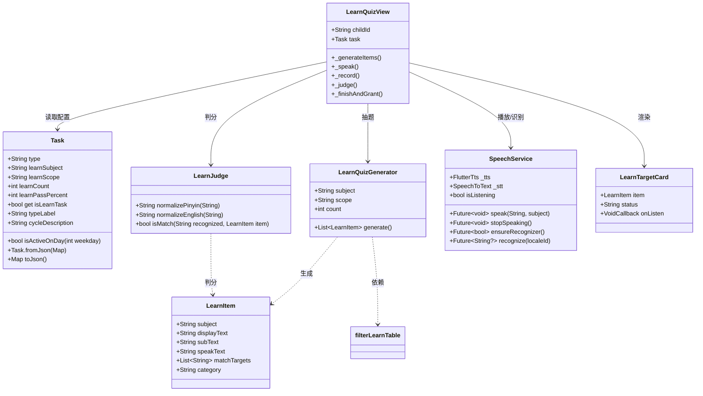
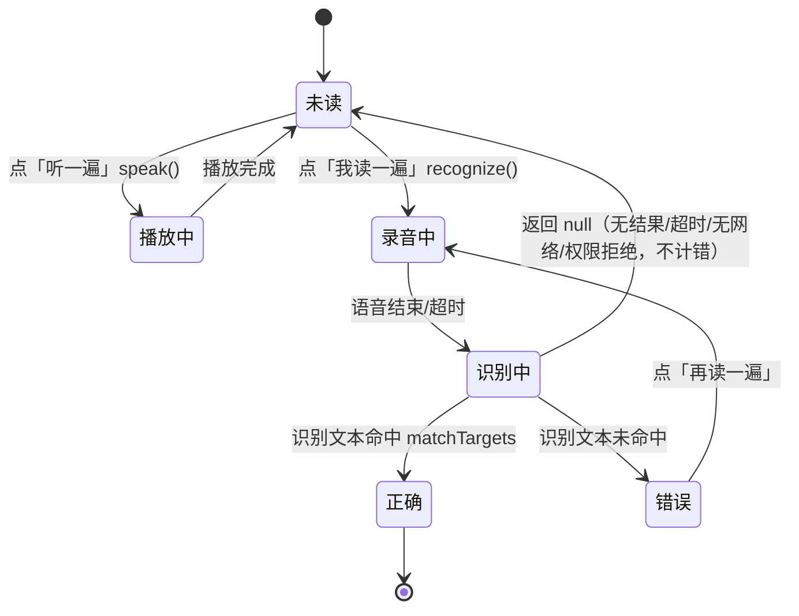
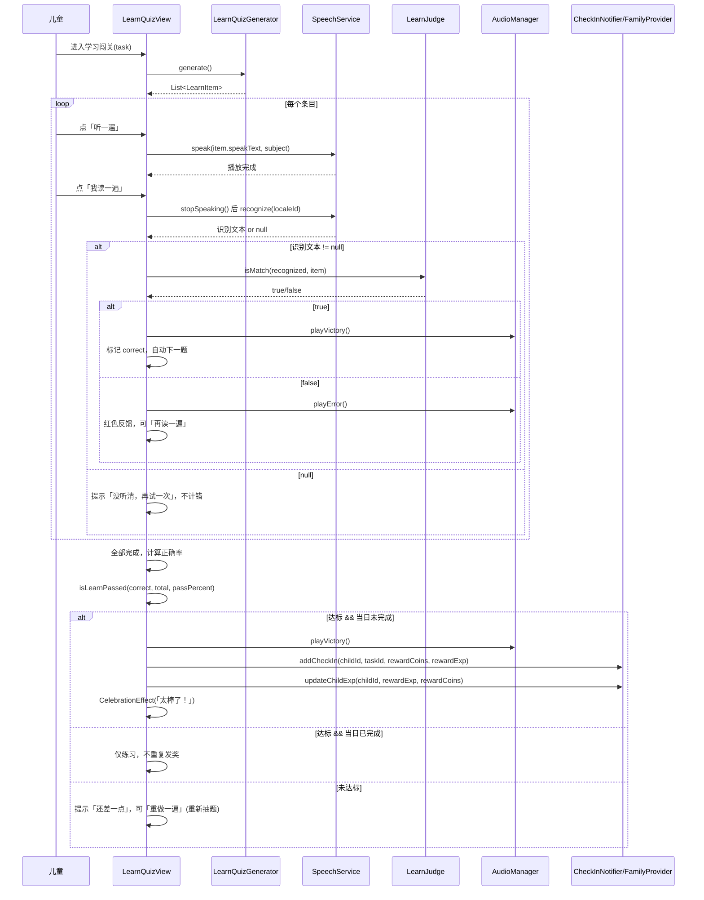
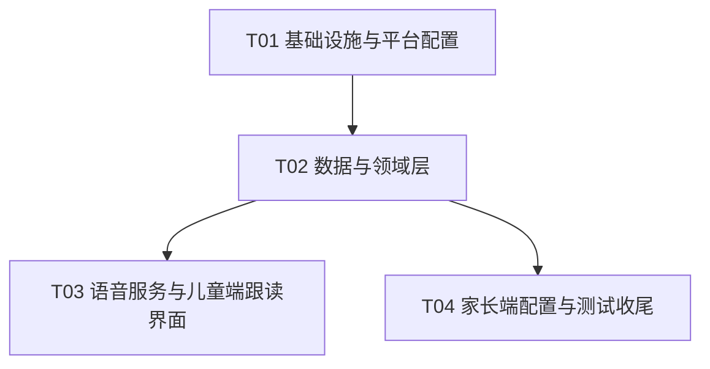

# 《英雄闯关计划》学习模块 —— 系统架构设计

> 架构师：高见远（Bob）
> 目标：在现有 Flutter + Riverpod + Hive 架构上，新增「学拼音 / 识字 / 学英语」三个语音跟读模块，复用数学闯关的成功范式。
> 关联 PRD：`docs/学习模块PRD.md`

---

## 1. 实现方案总览

### 1.1 核心结论

1. **统一任务类型 `type = 'learn'`**：与现有 `'math'` 并列，新增 `learnSubject / learnScope / learnCount / learnPassPercent` 四个字段（全部带默认值，向后兼容）。三个模块不各写一套任务类型，避免模型字段持续膨胀。
2. **三个模块共用一个 `LearnQuizView`**：通过 `learnSubject`（`pinyin/hanzi/english`）切换数据源、图标、TTS 语言与 STT 方言，最大程度复用「跟读 → 识别 → 判分 → 重读 → 达标发奖」的闭环代码。
3. **语音能力封装为独立 `SpeechService` 单例**：统一封装 `flutter_tts`（播放）+ `speech_to_text`（识别），供三个模块复用，不在 view 里散落插件调用。
4. **判分逻辑抽成纯函数 `LearnJudge`**：与 UI 完全解耦，可单测。拼音/识字做「去声调 + 去空格 + lowercase」近似匹配，英语做「lowercase + trim + 折叠空格」匹配。
5. **字库数据用 Dart `const` 列表内置**：拼音 / 识字 / 英语各一个独立数据文件，避免超大单文件；统一走 `LearnItem` 模型，与判分、抽题逻辑共享。
6. **达标发奖复用现有机制**：`addCheckIn` + `updateChildExp` + `CelebrationEffect`，防重复发奖（当日已完成仅练习）。

### 1.2 技术难点与选型

| 难点 | 方案 | 理由 |
| --- | --- | --- |
| 语音播放 | `flutter_tts`（3.x） | 系统 TTS，中文 `zh-CN` / 英文 `en-US`，跨平台成熟、无后端依赖 |
| 语音识别 | `speech_to_text`（7.5.0） | 封装 iOS `SFSpeechRecognizer` + Android `SpeechRecognizer`，返回识别文本，`localeId` 切方言，需联网 |
| 判分准确性 | 模糊匹配纯函数 | 语音识别天然有误差，用「声调无关 / 大小写空格不敏感」近似匹配，默认 80% 通过阈值 |
| 三模块复用 | `learnSubject` 切换 + 统一 `LearnItem` | 三个模块差异仅在数据源 + 图标 + 语言，UI 与闭环逻辑完全一致 |
| 向后兼容 | 新字段默认值 + `as X? ?? 默认` | Hive 老数据无新字段，反序列化自动填充默认值 |
| 离线/无权限降级 | 识别返回 `null` 视为「本次无效」 | 不计错、可重试，避免误伤儿童（见 §4 状态机） |

### 1.3 架构分层

沿用现有「data / domain / core / features」分层：

```
lib/
├── data/                 # 数据模型 + 字库静态数据
├── domain/               # 纯业务逻辑（判分、抽题、达标、预设模板）
├── core/
│   ├── services/         # SpeechService（语音能力封装，新增）
│   ├── utils/            # AudioManager（既有，复用胜利/错误音效）
│   └── widgets/          # UltramanStarfield / CelebrationEffect（既有，复用）
└── features/
    ├── child_adventure/  # LearnQuizView + 入口路由 + 目标卡片
    └── parent_console/   # 家长端任务编辑（学习任务配置）
```

---

## 2. 文件列表及相对路径

### 2.1 新增文件（8 个）

| # | 相对路径 | 说明 |
| --- | --- | --- |
| 1 | `lib/core/services/speech_service.dart` | 语音服务单例：TTS 播放 + STT 识别统一封装 |
| 2 | `lib/data/learn_content/learn_item.dart` | `LearnItem` 统一模型 + 学科常量 + 语言/方言映射 + 字库选择函数 |
| 3 | `lib/data/learn_content/pinyin_data.dart` | 拼音全表 63 项 `const` 列表（声母23+韵母24+整体认读16） |
| 4 | `lib/data/learn_content/hanzi_data.dart` | 识字常见字表 ~250 字（带拼音/组词）`const` 列表 |
| 5 | `lib/data/learn_content/english_data.dart` | 英语小学单词表 ~250 词（带中文释义）`const` 列表 |
| 6 | `lib/domain/learn_judge.dart` | 判分纯函数（声调无关 / 大小写空格不敏感） |
| 7 | `lib/domain/learn_quiz.dart` | 抽题生成器 `LearnQuizGenerator` + 达标判定 `isLearnPassed` |
| 8 | `lib/features/child_adventure/views/learn_quiz_view.dart` | 统一跟读闯关界面（三个模块共用） |
| 9 | `lib/features/child_adventure/widgets/learn_target_card.dart` | 超大字号目标卡片 + 麦克风脉冲按钮（可复用 UI 组件） |

### 2.2 修改文件（7 个）

| # | 相对路径 | 修改内容 |
| --- | --- | --- |
| 1 | `pubspec.yaml` | 新增 `flutter_tts`、`speech_to_text` 依赖 |
| 2 | `android/app/src/main/AndroidManifest.xml` | 新增 `RECORD_AUDIO` 权限 + 蓝牙权限 + `<queries>` 声明 |
| 3 | `ios/Runner/Info.plist` | 新增 `NSMicrophoneUsageDescription`、`NSSpeechRecognitionUsageDescription` |
| 4 | `lib/data/models/task.dart` | 扩展 4 个 learn 字段 + `isLearnTask` + `typeLabel`/`cycleDescription`/`isActiveOnDay` 分支 + `fromJson`/`toJson` |
| 5 | `lib/features/child_adventure/views/child_adventure_view.dart` | `_buildTaskCard` 入口路由判断 `isLearnTask` 进入 `LearnQuizView` + 学科图标 |
| 6 | `lib/domain/preset_templates.dart` | 新增 3 个学习预设模板 + `taskFromTemplate` 透传 learn 字段 |
| 7 | `lib/features/parent_console/views/task_edit_view.dart` | 新增「学习跟读」配置 UI（学科/范围/数量/阈值）+ 保存逻辑 |

### 2.3 测试文件（推荐，P1）

| # | 相对路径 | 说明 |
| --- | --- | --- |
| 1 | `test/learn_judge_test.dart` | `LearnJudge` 判分纯函数单测 |
| 2 | `test/learn_quiz_test.dart` | `LearnQuizGenerator` 抽题去重 / `isLearnPassed` 达标单测 |

> 说明：`check_in_logic.dart` 无需修改——`isAvailable` 的 `learn` 类型会落到 `return true` 默认分支（等同 daily），`isCompleted`/`isPending` 均按 `type` 无关的打卡记录判断，已天然支持学习任务。

---

## 3. 数据结构和接口设计

### 3.1 Task 模型扩展（`lib/data/models/task.dart`）

```dart
class Task {
  // ...既有字段不变...

  // ===== 学习跟读任务字段 (type == 'learn' 时生效) =====
  final String learnSubject;   // 'pinyin' / 'hanzi' / 'english'，默认 'pinyin'
  final String learnScope;     // 拼音 'shengmu/yunmu/zhengti/all'；识字/英语本轮 'all'，默认 'all'
  final int learnCount;        // 每天跟读条目数，默认 10
  final int learnPassPercent;  // 通过阈值百分比，默认 80

  // 构造函数新增（带默认值）
  this.learnSubject = 'pinyin',
  this.learnScope = 'all',
  this.learnCount = 10,
  this.learnPassPercent = 80,

  // 判断 getter
  bool get isLearnTask => type == 'learn';

  // fromJson 新增（全部 `as X? ?? 默认`）
  learnSubject: json['learnSubject'] as String? ?? 'pinyin',
  learnScope: json['learnScope'] as String? ?? 'all',
  learnCount: json['learnCount'] as int? ?? 10,
  learnPassPercent: json['learnPassPercent'] as int? ?? 80,

  // toJson 新增
  'learnSubject': learnSubject,
  'learnScope': learnScope,
  'learnCount': learnCount,
  'learnPassPercent': learnPassPercent,

  // typeLabel 新增分支
  case 'learn':
    return '每日跟读学习';

  // cycleDescription 新增分支
  case 'learn':
    return '每天跟读 $learnCount 个内容';

  // isActiveOnDay 新增分支（与 math/daily 一致，每日可做）
  case 'learn':
    return true;
}
```

> 向后兼容：老数据无 learn 字段时，`fromJson` 自动填充默认值；老任务 `type != 'learn'`，新字段不参与任何逻辑，互不影响。

### 3.2 字库统一模型（`lib/data/learn_content/learn_item.dart`）

```dart
/// 学科常量（与 task.type 的取值风格一致，用字符串）。
class LearnSubjects {
  static const String pinyin = 'pinyin';
  static const String hanzi = 'hanzi';
  static const String english = 'english';
}

/// 统一的跟读条目模型，三个模块共用。
class LearnItem {
  final String subject;          // LearnSubjects.pinyin / hanzi / english
  final String displayText;      // 大字号主展示：'b' / '人' / 'apple'
  final String subText;          // 辅助说明：拼音 'rén' / 组词 '大人' / 释义 '苹果'
  final String speakText;        // TTS 朗读文本（可与 displayText 不同，如声母呼读音 'bō'）
  final List<String> matchTargets; // 判分允许的等价目标（去声调/小写后比较），至少 1 项
  final String category;         // 拼音 shengmu/yunmu/zhengti；识字/英语 'all'（预留分级）

  const LearnItem({
    required this.subject,
    required this.displayText,
    this.subText = '',
    required this.speakText,
    required this.matchTargets,
    this.category = 'all',
  });
}

/// 学科 → TTS 语言。
String ttsLanguageOf(String subject) =>
    subject == LearnSubjects.english ? 'en-US' : 'zh-CN';

/// 学科 → 语音识别 localeId。
String sttLocaleOf(String subject) =>
    subject == LearnSubjects.english ? 'en_US' : 'zh_CN';

/// 学科中文名（家长端 / 儿童端展示用）。
String learnSubjectLabel(String subject) => switch (subject) {
      LearnSubjects.pinyin => '学拼音',
      LearnSubjects.hanzi => '识字',
      LearnSubjects.english => '学英语',
      _ => '学习',
    };

/// 依据学科返回对应字库（供抽题器与判分复用）。
List<LearnItem> learnTableFor(String subject) => switch (subject) {
      LearnSubjects.pinyin => pinyinTable,
      LearnSubjects.hanzi => hanziTable,
      LearnSubjects.english => englishWordTable,
      _ => const [],
    };

/// 按学科 + 范围过滤字库（拼音按 category 过滤，其余返回全部）。
List<LearnItem> filterLearnTable(String subject, String scope) {
  if (subject != LearnSubjects.pinyin || scope == 'all') {
    return learnTableFor(subject);
  }
  return pinyinTable.where((e) => e.category == scope).toList();
}
```

> 三个数据文件分别 `import` 本文件并 `export` 各自的 `const List<LearnItem>`，例如 `const List<LearnItem> pinyinTable = [...]`。

### 3.3 拼音字库（`lib/data/learn_content/pinyin_data.dart`）

```dart
// 结构：const List<LearnItem> pinyinTable = [ ... ];
// 示例：
const List<LearnItem> pinyinTable = [
  LearnItem(subject: 'pinyin', displayText: 'b', speakText: 'bō',
            matchTargets: ['b', 'bo'], category: 'shengmu'),
  // ... 声母23、韵母24、整体认读16，共 63 项 ...
];
```

关键约定（详见 §7 共享知识）：
- 声母 23：`b p m f d t n l g k h j q x zh ch sh r z c s y w`
- 韵母 24：`a o e i u ü ai ei ui ao ou iu ie üe er an en in un ün ang eng ing ong`
- 整体认读音节 16：`zhi chi shi ri zi ci si yi wu yu ye yue yuan yin yun ying`
- 声母 `speakText` 用**呼读音**（如 `b` → `bō`），避免 TTS 把 `b` 读成英文 `bee`；`matchTargets` 同时容纳声母字母与呼读音（如 `['b','bo']`），提升识别容错。

### 3.4 识字 / 英语字库

```dart
// hanzi_data.dart
// LearnItem(subject:'hanzi', displayText:'人', subText:'rén · 大人',
//           speakText:'人', matchTargets:['ren'], category:'all')

// english_data.dart
// LearnItem(subject:'english', displayText:'apple', subText:'苹果',
//           speakText:'apple', matchTargets:['apple'], category:'all')
```

### 3.5 判分纯函数（`lib/domain/learn_judge.dart`）

```dart
class LearnJudge {
  LearnJudge._();

  /// 拼音/识字归一化：NFD 分解 → 去组合声调符 → ü 系列转 'v' → lowercase → 去空格。
  static String normalizePinyin(String input);

  /// 英语归一化：lowercase → trim → 折叠连续空格为单个。
  static String normalizeEnglish(String input);

  /// 统一判分入口：对 item.matchTargets 逐个归一化比较。
  /// 返回 true 表示识别结果与任一目标近似匹配。
  static bool isMatch({required String recognized, required LearnItem item});
}
```

签名补充：

```dart
// 判定单条是否答对（按学科选择归一化策略）。
static bool isMatch({required String recognized, required LearnItem item}) {
  final r = item.subject == LearnSubjects.english
      ? normalizeEnglish(recognized)
      : normalizePinyin(recognized);
  for (final t in item.matchTargets) {
    final norm = item.subject == LearnSubjects.english
        ? normalizeEnglish(t)
        : normalizePinyin(t);
    if (norm.isNotEmpty && norm == r) return true;
  }
  return false;
}
```

### 3.6 抽题与达标（`lib/domain/learn_quiz.dart`）

```dart
class LearnQuizGenerator {
  final String subject;
  final String scope;
  final int count;
  final math.Random _rng;
  LearnQuizGenerator({
    required this.subject,
    required this.scope,
    required this.count,
    math.Random? rng,
  }) : _rng = rng ?? math.Random();

  /// 从字库按 scope 过滤后，随机抽取 [count] 项（去重；不足时返回可得的全部）。
  List<LearnItem> generate();
}

/// 达标判定：正确数 >= ceil(总数 × passPercent / 100)。
bool isLearnPassed(int correct, int total, int passPercent) {
  if (total <= 0) return false;
  return correct >= (total * passPercent / 100).ceil();
}
```

### 3.7 语音服务封装（`lib/core/services/speech_service.dart`）

```dart
/// 语音能力统一封装：TTS 播放 + 语音识别，单例，供三个模块复用。
class SpeechService {
  static final SpeechService instance = SpeechService._();
  SpeechService._();

  final FlutterTts _tts = FlutterTts();
  final SpeechToText _stt = SpeechToText();
  bool _sttInitialized = false;
  bool _ttsConfigured = false;

  /// 配置 TTS 默认参数（语速/音量/音调），懒初始化。
  Future<void> _ensureTts();

  /// 朗读文本（按学科设置语言）。播放前先 stop 上次播放。
  Future<void> speak(String text, {required String subject});

  /// 立即停止朗读。
  Future<void> stopSpeaking();

  /// 初始化语音识别（每应用会话只初始化一次，返回是否可用/是否已授权）。
  Future<bool> ensureRecognizer();

  /// 开始识别，返回最终识别文本；失败/无结果/权限拒绝返回 null（视为「本次无效」）。
  /// [onPartial] 用于实时显示识别中的文字气泡。
  Future<String?> recognize({
    required String localeId,
    Duration listenFor = const Duration(seconds: 8),
    Duration pauseFor = const Duration(seconds: 2),
    void Function(String partial)? onPartial,
  });

  /// 是否正在监听。
  bool get isListening;

  /// 停止/取消监听。
  Future<void> stopRecognition();
  Future<void> cancelRecognition();

  /// 释放插件资源（页面 dispose 时调用）。
  void dispose();
}
```

> 关键：`speech_to_text` 每应用会话只能 `initialize` 一次，且应全局单例——因此 SpeechService 用单例 + `_sttInitialized` 懒初始化标记；`flutter_tts` 与 `speech_to_text` 共用音频通道，**识别前必须先 `stopSpeaking()`**，否则可能出现录音抢占。

### 3.8 类关系图（classDiagram）

见 `docs/class-diagram.mermaid`，亦嵌入如下：



---

## 4. 程序调用流程（跟读闭环）

### 4.1 单条跟读状态机



### 4.2 完整时序（sequenceDiagram）

见 `docs/sequence-diagram.mermaid`，亦嵌入如下：



---

## 5. 任务列表（按实现顺序）

> 分组原则：按层次分组，每个任务 ≥3 个文件；任务尽量只依赖 T01，减少线性依赖链。共 4 个任务。

| 任务 ID | 任务名 | 涉及文件 | 依赖 | 优先级 |
| --- | --- | --- | --- | --- |
| **T01** | 项目基础设施与平台配置 | `pubspec.yaml`（新增 flutter_tts / speech_to_text）；`android/app/src/main/AndroidManifest.xml`（RECORD_AUDIO + 蓝牙 + queries）；`ios/Runner/Info.plist`（麦克风/语音识别用途） | — | P0 |
| **T02** | 数据与领域层 | `lib/data/models/task.dart`（改）；`lib/data/learn_content/learn_item.dart`（新）；`lib/data/learn_content/pinyin_data.dart`（新）；`lib/data/learn_content/hanzi_data.dart`（新）；`lib/data/learn_content/english_data.dart`（新）；`lib/domain/learn_judge.dart`（新）；`lib/domain/learn_quiz.dart`（新）；`lib/domain/preset_templates.dart`（改） | T01 | P0 |
| **T03** | 语音服务与儿童端跟读界面 | `lib/core/services/speech_service.dart`（新）；`lib/features/child_adventure/widgets/learn_target_card.dart`（新）；`lib/features/child_adventure/views/learn_quiz_view.dart`（新）；`lib/features/child_adventure/views/child_adventure_view.dart`（改） | T01、T02 | P0 |
| **T04** | 家长端配置与测试收尾 | `lib/features/parent_console/views/task_edit_view.dart`（改）；`test/learn_judge_test.dart`（新）；`test/learn_quiz_test.dart`（新） | T02 | P0/P1 |

### 任务依赖图



### 各任务要点

**T01 基础设施与平台配置**
- `pubspec.yaml`：`flutter_tts: ^3.8.0`、`speech_to_text: ^7.5.0`。
- AndroidManifest：`RECORD_AUDIO`（必填）；蓝牙 `BLUETOOTH / BLUETOOTH_ADMIN / BLUETOOTH_CONNECT`（官方推荐，蓝牙耳机识别）；`<queries>` 增加 `android.speech.RecognitionService` 与 `android.intent.action.TTS_SERVICE`。
- Info.plist：`NSMicrophoneUsageDescription`、`NSSpeechRecognitionUsageDescription`（中文用途说明）。

**T02 数据与领域层**
- Task 扩展（默认值 + getter + label/description + 序列化），向后兼容。
- 建立 `LearnItem` 统一模型 + 三张 const 字库（拼音 63 项完整、识字/英语 ~250 项）。
- 判分纯函数 + 抽题生成器 + 达标判定 + 3 个预设模板。

**T03 语音服务与儿童端跟读界面**
- `SpeechService` 单例：TTS + STT 封装、懒初始化、识别前停播。
- `LearnTargetCard`：超大字号目标卡片 + 麦克风脉冲按钮 + 对错边框。
- `LearnQuizView`：复用 `UltramanStarfield` / `CelebrationEffect` / 横屏分栏（左目标卡、右操作按钮），底部「听一遍 / 我读一遍 / 下一题」三按钮。
- `child_adventure_view.dart`：`_buildTaskCard` 判断 `isLearnTask` 进入 `LearnQuizView`，学科图标 `record_voice_over / text_fields / abc`。

**T04 家长端配置与测试收尾**
- `task_edit_view.dart`：新增「学习跟读」开关 + 学科三选一 ChoiceChip + 范围（拼音四选一，识字/英语本轮「全部」）+ 数量（5/10/20+自定义）+ 阈值（60/80/100+自定义）；保存时 `type='learn'`，与 `_isMathTask` 互斥。
- 单测：判分归一化（声调/大小写/空格/ü）、抽题去重、达标边界。

---

## 6. 依赖包列表（含版本）

```
- flutter_tts: ^3.8.0        # 语音播放（中文 zh-CN / 英文 en-US），团队确认沿用 3.x（最新 4.x 暂不采用）
- speech_to_text: ^7.5.0     # 语音识别（zh_CN / en_US，需联网）
```

> 无需额外引入 `permission_handler`：`speech_to_text` 在 `initialize()` 内部完成麦克风权限申请。

### 平台配置要求

**Android（`android/app/src/main/AndroidManifest.xml`）**
```xml
<uses-permission android:name="android.permission.RECORD_AUDIO"/>
<uses-permission android:name="android.permission.INTERNET"/> <!-- 已存在 -->
<uses-permission android:name="android.permission.BLUETOOTH"/>
<uses-permission android:name="android.permission.BLUETOOTH_ADMIN"/>
<uses-permission android:name="android.permission.BLUETOOTH_CONNECT"/>

<queries>
  <intent><action android:name="android.speech.RecognitionService"/></intent>
  <intent><action android:name="android.intent.action.TTS_SERVICE"/></intent>
</queries>
```
- `minSdkVersion` 需 ≥ 21（项目 `flutter.minSdkVersion` 已满足）。

**iOS（`ios/Runner/Info.plist`）**
```xml
<key>NSMicrophoneUsageDescription</key>
<string>用于跟读学习时采集小朋友的发音进行判分</string>
<key>NSSpeechRecognitionUsageDescription</key>
<string>用于识别小朋友的跟读内容，判断发音是否正确</string>
```

---

## 7. 共享知识（跨文件约定）

1. **任务类型**：`type='learn'` 表示学习跟读任务，与 `'math'` 并列；新增字段一律带默认值，`fromJson` 用 `as X? ?? 默认`。
2. **学科取值**：`pinyin / hanzi / english`，统一使用 `LearnSubjects` 常量，不要散落硬编码字符串。
3. **字库数据结构**：三个数据文件都导出 `const List<LearnItem>`，通过 `learnTableFor(subject)` 获取；拼音用 `category` 字段（`shengmu/yunmu/zhengti`）支持范围过滤。
4. **判分规则常量**：
   - 拼音/识字：NFD 分解 → 去组合声调符（Mn 类）→ `ü/ǖ/ǘ/ǚ/ǜ` → `v` → lowercase → 去空格。
   - 英语：lowercase → trim → 折叠连续空格。
   - 识别为空串/`null` → 「本次无效」，不计错、可重试。
5. **语音服务单例**：只通过 `SpeechService.instance` 访问；`speech_to_text` 每会话只 `initialize` 一次；**识别前先 `stopSpeaking()`**。
6. **TTS/STT 语言映射**：`pinyin/hanzi` → TTS `zh-CN`、STT `zh_CN`；`english` → TTS `en-US`、STT `en_US`（由 `ttsLanguageOf/sttLocaleOf` 提供）。
7. **声母呼读音**：声母 `speakText` 用呼读音（`b→bō` 等），`matchTargets` 同时容纳声母字母与呼读音，规避 TTS 读成英文、识别偏差。
8. **达标公式**：`correct >= ceil(total * learnPassPercent / 100)`，默认阈值 80。
9. **发奖**：仅「达标 && 当日未完成」时调用 `addCheckIn` + `updateChildExp`；复用 `CelebrationEffect`；胜利/错误音效复用 `AudioManager().playVictory()/playError()`。
10. **UI 风格**：复用 `UltramanStarfield()` 背景 + `CelebrationEffect`；横屏左（目标卡/进度）右（操作按钮）分栏，`maxWidth` 横屏 ≤1080、竖屏 ≤720；不使用 `screenutil` 放大（避免平板溢出），沿用 MathQuizView 的普通逻辑像素做法。

---

## 8. 待明确事项

1. **英语达标阈值**：PRD 建议英语默认 60%（识别难度更高），本设计统一默认 80%。需产品确认英语是否单独放宽默认值（可简单实现为「英语默认 60、其余 80」）。
2. **声母呼读音的准确表**：`speakText`/`matchTargets` 的呼读音映射（`b→bō` 等 23 项）需按标准拼音教学表最终确认，避免与学校教学不一致。
3. **`ü` 归一化**：本设计约定 `ü` 系列统一转 `v`（键盘输入习惯），若识别引擎返回 `u` 或 `yu` 可能导致漏判，需实测后决定是否在 `matchTargets` 额外容纳 `u/yv` 等变体。
4. **识字/英语范围细分**：本轮识字/英语统一 `scope='all'`，按「一年级上/下」「年级/主题」细分留 P2，数据 `category` 字段已预留。
5. **离线兜底**：`speech_to_text` 需联网，断网时本设计仅提示「当前无法识别」并可重试，不提供「手动标记完成」兜底（避免误发奖励）。是否需要人工兜底需产品确认。
6. **英语 TTS 音源兜底**：部分安卓设备缺少英文 TTS，`flutter_tts` 需 `isLanguageAvailable('en-US')` 探测并在缺失时提示。本设计在 SpeechService 中预留检测点，具体文案待定。
7. **字库版权**：识字/英语字表按公开大纲/高频词整理，数据文件头注释需注明来源，避免直接照搬教材排版。
